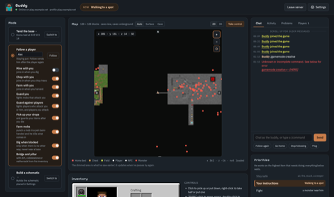
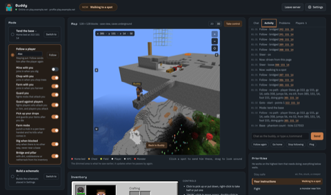
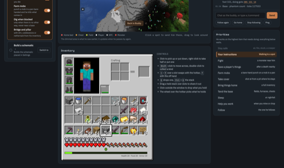
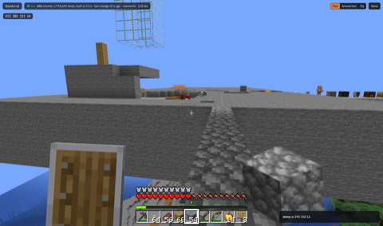
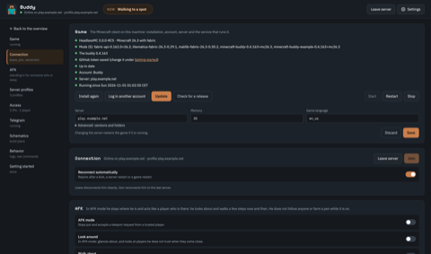
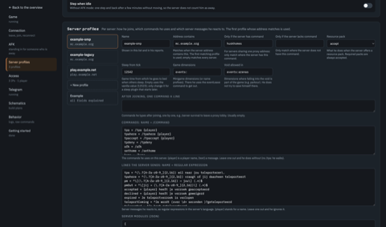
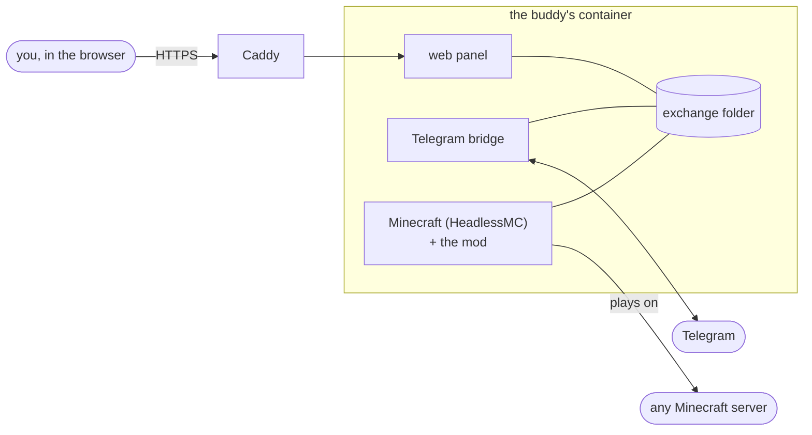

<div align="center">

# Minecraft Buddy

A second Minecraft account that plays with you: following you, guarding you, working along, keeping your base and
bringing back your things when you die. The buddy runs on a machine without a screen; you watch and steer from a web
panel or Telegram.


</div>

---

The buddy is a client-side Fabric mod that plays a second account of your own the way a person does: real keys, real
clicks, a human pace, nothing a player may not do. Any server will do; what differs per server is a profile in the
buddy's settings, filled in once.

## Screenshots

Click one for the full size.

| | | |
|:---:|:---:|:---:|
| [](docs/screenshots/overview.png) | [](docs/screenshots/overview-3d.png) | [](docs/screenshots/inventory.png) |
| The overview: modes and their switches, the map around the buddy and the chat | The map in 3D, and the Activity tab with what the buddy does | The buddy's inventory as the game draws it, and the priorities in order |
| [](docs/screenshots/take-control.png) | [](docs/screenshots/settings.png) | [](docs/screenshots/profiles.png) |
| Take control: play the buddy in first person in 3D | Settings: the game, the connection | Server profiles: the buddy's commands and the server lines the buddy reacts to |

## Features

**In the game**

- **Follows you** on foot, swimming, climbing, by elytra, on your happy ghast or in your boat, and finds a way:
  digging through a wall, bridging a gap or building up when walking does not get there, never through lava.
- **Guards you** against monsters and, if you want, players: a shield up between blows, critical hits, a bow for what
  is out of reach, a totem in the off hand whenever there is one, golden apples to heal.
- **Brings back your things** when you die nearby, the most valuable first, and throws them at your feet.
- **Works along** when you tap a block: digs your tunnel and lights it, chops the trees you chop, keeps a field, keeps
  a row of furnaces going.
- **Keeps your base** when you leave the buddy there: harvests and replants, stores in your chests, shears sheep, leads
  strays back, replaces worn tools and armour, and sleeps at night.
- **Farms mobs**: punch a monster in your farm's pen and the buddy takes the edge and kills what comes in, backing off
  when it gets dangerous.

**Around the game**

- **Web panel**: a live map, the buddy's inventory as the game draws it (click, drag and drop as in the game), the
  server chat, a 3D view to take control with keyboard and mouse, and every setting.
- **Telegram**: the game chat shows up in a Telegram chat; a line you type there the buddy says in the game, and a line
  starting with `!` is a command.
- **Docker**: one image and one compose file, a setup wizard in the browser, HTTPS, updates from the panel when a new
  version is out, and several buddies on one machine.
- **Server profiles and modules**: a server's commands and chat lines are settings; what only one server has is a
  module next to the core.

## How it fits together



The game runs without a window through [HeadlessMC](https://github.com/3arthqu4ke/headlessmc). Everything outside the
game talks to the mod through files in one folder, so the panel, the bridge and your own scripts all use the same
[commands and events](docs/exchange.md).

## Quick start

You need a Linux machine with Docker, a domain that points at it, and a second Minecraft Java Edition account for the
buddy.

```bash
mkdir buddies && cd buddies
docker run --rm ghcr.io/minecraftbuddy/minecraft-buddy compose > compose.yaml
# put the buddy's domain in compose.yaml, at  caddy: steve.example.net
docker compose up -d
docker compose logs steve                 # the setup code
```

Open the buddy's domain, type the code, choose an owner password, and follow **Getting started** in the panel:

1. install the game (a few minutes),
2. log in the buddy's Minecraft account (a Microsoft link),
3. type the server to play on,
4. join: the buddy stays on. After a crash or a reboot the game starts again, and after a kick or a lost connection the
   buddy joins again after about half a minute.

`compose.yaml` holds every buddy on the machine, with one Caddy for all. A buddy is two blocks: the buddy, and its own
Watchtower, so that an update in one panel replaces that buddy alone. A second buddy is a copy of both blocks with
another name and domain. [Installing](docs/install.md) has the rest: a buddy without a domain, and a port of your own
when nginx or Apache holds ports 80 and 443 ([Beside another web server](docs/install.md#beside-another-web-server)).

## Talking to the buddy

Nothing needs a command. Stand near the buddy and:

| You | The buddy |
|---|---|
| look at the buddy and crouch twice | stays here, or follows again |
| do the same with a sword in your hand | starts or stops guarding you |
| tap a block with your bare hand | starts or stops a job: dig, chop, harvest, run furnaces, or "this is home" on a bed |
| punch a monster in your mob farm | farms it |
| throw things at the buddy | takes them home to your chests |

The buddy answers with a nod (yes, on), one crouch (off) or a shake of the head (no).
[How the buddy behaves](docs/behaviour.md) has every sign, what the buddy does unasked, and how the buddy decides what
comes first.

## Settings

The settings are in `buddy.json` in the exchange folder, and nearly all of them in the panel: whom to follow, who may
steer, the modes and their switches. A server that needs something special (its `/tpa`, its sleeping rules, a proxy
lobby) gets a [server profile](docs/profiles.md):

```json
{ "name": "my-server", "address": "play.example.net",
  "commands": { "tpa": "/tpa {player}", "home": "/home" },
  "resourcepack": "accept" }
```

## Documentation

| | |
|---|---|
| [Installing](docs/install.md) | `compose.yaml`, domains and certificates, several buddies, updates |
| [How the buddy behaves](docs/behaviour.md) | the signs, what the buddy does unasked, jobs, mob farms, getting about, priorities, what the buddy carries |
| [Server profiles and modules](docs/profiles.md) | per-server commands and chat lines, modules |
| [The web panel](docs/panel.md) | what is on it, and who may open it |
| [Telegram](docs/telegram.md) | setting up the bot and the `!` commands |
| [The exchange folder](docs/exchange.md) | the files and commands for your own scripts |
| [Building and testing](docs/development.md) | building, trying a jar, reading the buddy's logs, contributing |

## Building from source

```bash
./gradlew build -Pmc=26.3       # the mod and its modules, with the tests (JDK 25)
bash docker/build.sh            # the Docker image, as minecraft-buddy:dev
```

A push to `master` pushes the image to `ghcr.io/minecraftbuddy/minecraft-buddy` and puts the jars on a GitHub release;
the panel sees the new version and offers the update. [Building and testing](docs/development.md) has the rest, and how
to contribute.

## Playing fair

The buddy plays by the server's rules: no hitting through blocks, a human pace, no automation the server forbids for
players. Check what a server allows before you let the buddy work there. Digging and building on the way can be
switched off (`pathDig`, `pathPlace`).

## Credits

The buddy stands on the work of others, and borrows ideas from more:

- [HeadlessMC](https://github.com/3arthqu4ke/headlessmc): the launcher that runs the game without a window.
- [Fabric](https://github.com/FabricMC): the loader, the API and Loom the mod is built with.
- [Litematica](https://github.com/maruohon/litematica) and [MaLiLib](https://github.com/maruohon/malilib) by masa,
  kept up to date by [sakura-ryoko](https://github.com/sakura-ryoko/litematica): the schematics the builder works from.
- [three.js](https://github.com/mrdoob/three.js): the panel's view of the world in 3D.
- [Caddy](https://github.com/caddyserver/caddy) with [caddy-docker-proxy](https://github.com/lucaslorentz/caddy-docker-proxy),
  and [Watchtower](https://github.com/nicholas-fedor/watchtower) (Nicholas Fedor's fork, carried on from
  [containrrr's](https://github.com/containrrr/watchtower)): HTTPS and updates in the Docker set-up.
- Ideas for how the buddy decides, gets loose and gives up were taken from
  [PlayerEngine](https://github.com/shakey2/PlayerEngine), [SoulFire](https://github.com/AlexProgrammerDE/SoulFire)
  and [Botcraft](https://github.com/adepierre/Botcraft).

## License

[GNU Affero General Public License 3.0 or later](LICENSE). You may use, change and share the buddy; whoever shares or
runs a changed version, also as a service on a server, makes the changed source available under the same license.
The bundled three.js is MIT ([panel/3d/THREE-LICENSE](panel/3d/THREE-LICENSE)) and the fonts are under the SIL Open Font
License ([panel/fonts/OFL.txt](panel/fonts/OFL.txt)).
