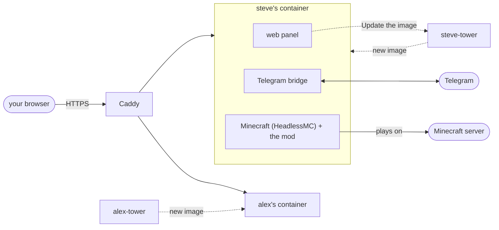

# Installing

The buddy runs in Docker. One file, `compose.yaml`, holds every buddy on a machine, the Caddy that gives each buddy's
domain HTTPS, and a Watchtower per buddy for the update button in its panel. Nothing is installed on the machine itself.

Each buddy needs a second Minecraft Java Edition account, which you log in once from the panel, and about 3 GB of
memory on the machine.

## The first buddy

What you need: a Linux machine with Docker and Docker Compose, ports 80 and 443 open (or a port of your own when another
web server holds them: [Beside another web server](#beside-another-web-server)), and a domain whose DNS points at
the machine.

```bash
mkdir buddies && cd buddies
docker run --rm ghcr.io/minecraftbuddy/minecraft-buddy compose > compose.yaml
```

Open `compose.yaml` and put the buddy's domain in the label `caddy` of the block `steve` (rename the block too if you
like; the name is in three places, see [Another buddy](#another-buddy)). Then:

```bash
docker compose up -d
docker compose logs steve     # the setup code
```

Caddy gets a certificate from Let's Encrypt within a minute. Open `https://<domain>`, type the setup code and choose
the **owner password**. The panel then opens **Getting started**, four steps:

1. Install the game: HeadlessMC, Minecraft with Fabric, the mods and the buddy. It takes a few minutes.
2. Log in the buddy's Minecraft account: the panel shows a Microsoft link; sign in there with that account.
3. Type the address of the server to play on. A [server profile](profiles.md) is optional.
4. Join. The buddy stays on: after a crash, a restart of the container or a reboot the game starts again, and after a
   kick or a lost connection the buddy joins again after about half a minute. Leave, in the panel's header, keeps the
   buddy off the server until Join.

## Another buddy

Every buddy is two blocks under `services`: the buddy, and its own Watchtower for the panel's Update. A volume has the
buddy's name. For a second one, copy both blocks of the first and replace the name everywhere in them:

```yaml
  alex:
    <<: *buddy
    environment:
      <<: *env
      WATCHTOWER_URL: http://alex-tower:8080
    volumes: [alex:/data, tower:/tower:ro]
    labels:
      <<: *labels
      com.centurylinklabs.watchtower.scope: alex
      caddy: alex.example.net
  alex-tower:
    <<: *tower
    environment: {<<: *tower-env, WATCHTOWER_SCOPE: alex}
    labels: {com.centurylinklabs.watchtower.scope: alex}
```

and add the new volume at the bottom:

```yaml
volumes:
  caddy:
  tower:
  steve:
  alex:
```

The name stands in both blocks and under `volumes:`. A copied block that keeps the old name in its scope gets updated
with that buddy. `docker compose up -d` then starts
the new buddy and leaves the others alone, and `docker compose logs alex` has the new setup code. Every buddy needs a
separate Minecraft account and a separate Telegram bot: Telegram lets one program at a time read a bot's messages.

To take a buddy away: `docker compose rm -sf alex alex-tower`, delete both blocks, and `docker volume rm buddy_alex` when nothing kept
there is needed any more.

## Other set-ups

The first four are written out in `compose.yaml` as comments.

| | How |
|---|---|
| Several names for one buddy | `caddy: steve.example.net, steve.example.org` |
| No domain: the machine's address and a port you choose | in the buddy's labels `caddy: https://203.0.113.5:20443` and `caddy.tls: internal`, and at `caddy` the label `caddy.default_sni: 203.0.113.5`; the certificate is Caddy's own, so the browser warns once |
| Beside another web server that holds ports 80 and 443 (nginx, Apache) | four labels at `caddy`: [Beside another web server](#beside-another-web-server) |
| A buddy that plays on a server on the same machine (`127.0.0.1`) | `network_mode: host`, the panel on a separate port of `127.0.0.1` (`BUDDY_LISTEN`, `BUDDY_PANEL_PORT`, `BUDDY_PROXY_HOST: localhost`), its Watchtower on a port of `127.0.0.1` too (`ports` at the Watchtower, `WATCHTOWER_URL` at the buddy, one port per such buddy), and `caddy.reverse_proxy: 127.0.0.1:<that port>` |
| A machine where new versions of the buddy are tried | `BUDDY_JARS: folder` in the buddy's environment: the jars in the mods folder are used, not the image's |

Let's Encrypt checks a domain over port 80, also when the panel is on another port, so keep port 80 reachable.

## Beside another web server

When nginx, Apache or another program already holds ports 80 and 443, the buddies can use a port you choose, and
nothing of that web server or its config is touched. In `compose.yaml`, at `caddy`, take the `#` away from these four
labels and choose the port (`caddy.admin: "off"` above them stays as it is):

```yaml
    labels:
      caddy.https_port: "20443"
      caddy.auto_https: disable_redirects
      caddy.local_certs: ""
      caddy.skip_install_trust: ""
```

Then `docker compose up -d`, and open that port in the machine's firewall. Each buddy's domain stays in the label
`caddy`, and the panel is at `https://<domain>:20443`; several buddies share the port, told apart by domain. Caddy
listens on that port alone: no redirect from port 80, nothing on 443.

The certificate is Caddy's own, because Let's Encrypt checks a domain only over ports 80 and 443, which are the other
web server's. The browser warns the first time on every device. To stop that, trust Caddy's root certificate on your
device once (it lasts ten years; Caddy renews the rest by itself):

```bash
docker compose cp caddy:/data/caddy/pki/authorities/local/root.crt caddy-root.crt
```

and open `caddy-root.crt` on the device (on a Mac in Keychain Access, set to Always Trust; on Windows in the store
Trusted Root Certification Authorities). Keep the volume `caddy`: a new one makes a new root, and every device warns
again.

## Everyday things

All in the folder of `compose.yaml`, with the buddy's name for `steve`:

| What | How |
|---|---|
| The setup code again | `docker compose logs steve` |
| Update to the newest version | when a newer version is out, click the version under the panel's header buttons, or use the update button in Settings, Status (see [Updates](#updates)); or `docker compose pull && docker compose up -d` |
| A fixed version | `ghcr.io/minecraftbuddy/minecraft-buddy:<version>` (the version of a [release](https://github.com/MinecraftBuddy/minecraft-buddy/releases)) in place of `:latest`, then `docker compose up -d` |
| Stop and start one | `docker compose stop steve`, `docker compose start steve` |
| The game's own log | `docker compose exec steve cat .local/state/buddy/game.log` |
| A command of the buddy's game | `docker compose exec steve python3 /opt/buddy/panel/game.py status` (also `restart`, `server ADDRESS`, `path mods`) |
| Everything away, and all that was kept | `docker compose down -v`, then delete the folder |

Everything a buddy keeps (the game, the account, the settings, what was learnt) is in the buddy's volume and stays over
updates.

## Updates

Every panel looks once an hour at the newest [release](https://github.com/MinecraftBuddy/minecraft-buddy/releases) on
GitHub, without a login. When the release is newer than the buddy's image, the version under the header's buttons gets
an arrow, and Settings, Status says what is out, with a link to what changed.

A click on the version with the arrow, or the update button in Settings, Status, asks first. The buddy's own
Watchtower then pulls the new image and starts that buddy again: the buddy is offline for a minute or two. Other buddies
on the machine keep running on their version until their own panel updates them. The volumes and
everything in them stay, the Minecraft login too: when Minecraft refuses the old login after the update, the buddy
fetches a new one, without a Microsoft link.

`BUDDY_UPDATE_CHECK: "off"` in a buddy's environment stops the look at GitHub; the button still works.

A `compose.yaml` from before 0.5.14 has one Watchtower for every buddy: an Update in one panel replaces them all. To give
each buddy its own, take `x-tower`, `x-tower-env` and a buddy's two blocks from
`docker run --rm ghcr.io/minecraftbuddy/minecraft-buddy compose`, write each buddy's own name in them, delete the block
`watchtower`, and run `docker compose up -d --remove-orphans`. That starts every buddy again once.

## What runs



- **The buddies**: the panel, the Telegram bridge and the game in one container each, on the network `buddies`.
- **Caddy** ([caddy-docker-proxy](https://github.com/lucaslorentz/caddy-docker-proxy)) runs on the machine's network,
  holds ports 80 and 443 (or [a port of your own](#beside-another-web-server)), and reads each buddy's site from the labels
  of that buddy's block, through the Docker socket, read-only. Its admin API is off (`caddy.admin: "off"`): on the
  machine's network it would let every program on the machine change Caddy's config.
- **The panels** have no port on the machine; only Caddy reaches them. A panel believes the visitor's address only from
  Caddy, and only with the secret Caddy adds to every request (`X-Buddy-Proxy`): every other program on the machine
  reaches a panel from the same address as Caddy, and could otherwise pose as a trusted address.
- **A Watchtower per buddy** (`steve-tower`) fetches a new image when that buddy's panel asks, and replaces that buddy
  alone. Its scope is the buddy's name (`WATCHTOWER_SCOPE`, and the label `com.centurylinklabs.watchtower.scope` on both
  blocks), so it sees no other buddy, and no other Watchtower stops it. The old image goes once no running buddy uses it.
- **tower-token** makes two secrets once: the token between the panels and their Watchtowers, in the volume `tower`, and the
  secret Caddy sends the panels, in Caddy's own volume `caddy`, with its SHA-256 for the panels in `tower` (a buddy can
  read that, but cannot make the secret from it). When a buddy's log says that Caddy sends no secret, the machine's
  `compose.yaml` is older than the image's: copy `BUDDY_PROXY_SECRET_FILE`, the label `caddy.reverse_proxy.header_up`,
  the `depends_on` of Caddy and the buddies, and tower-token's command and volumes from
  `docker run --rm ghcr.io/minecraftbuddy/minecraft-buddy compose`.

## Who may open the panel

- **The owner password** opens everything, from anywhere. Change it in Settings, Access, where Log out is too. Log out
  ends the session on the panel as well; a new password ends every session.
- **Trusted addresses** in Settings, Access may steer the buddy without a password.
- **Anyone else** gets the login page and nothing more.

Ten wrong passwords from one address in ten minutes, and that address waits; an IPv6 address counts as its /64. A
hundred wrong passwords in ten minutes from all addresses together, and every password login waits (a trusted address
still gets in). Passwords are checked one at a time, so a flood of logins takes one core and not the machine.

← [Back to the README](../README.md)
