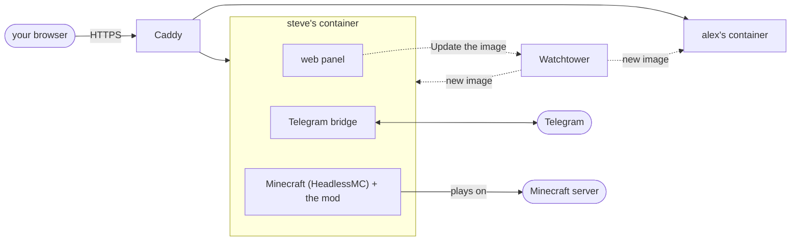

# Installing

The buddy runs in Docker. One file, `compose.yaml`, holds every buddy of a machine, the Caddy that gives each of them
HTTPS on their own domain, and Watchtower for the update button in their panel. Nothing is installed on the machine itself.

The buddy is a second Minecraft account: one with Java Edition, which you log in once from the panel. The buddy needs about
3 GB of memory on the machine.

## The first buddy

What you need: a Linux machine with Docker and Docker Compose, ports 80 and 443 open (or a port of your own when another
web server holds them: [Beside another web server](#beside-another-web-server)), and a domain whose DNS points at
the machine.

```bash
mkdir buddies && cd buddies
docker run --rm ghcr.io/minecraftbuddy/minecraft-buddy compose > compose.yaml
```

Open `compose.yaml` and put the buddy's domain in the label `caddy` of the block `steve` (rename the block too if you like; the
name is in three places, see [Another buddy](#another-buddy)). Then:

```bash
docker compose up -d
docker compose logs steve     # the setup code
```

Caddy gets a certificate from Let's Encrypt within a minute. Open `https://<their domain>`, type the setup code and choose
the **owner password**. The panel then opens **Getting started**, four steps:

1. **Install the game**: HeadlessMC, Minecraft with Fabric, the mods and the buddy, a few minutes.
2. **Log in their Minecraft account**: the panel shows a Microsoft link, you sign in there with their account.
3. **The server they play on**: its address. A [server profile](profiles.md) is optional.
4. **Join**: they join and stay on. After a crash, a restart of the container or a reboot they come back by themselves.

## Another buddy

Every buddy is a block under `services`, with a volume of their own. For a second one, copy the block of the first:

```yaml
  alex:
    <<: *buddy
    environment: *env
    volumes: [alex:/data, tower:/tower:ro]
    labels:
      <<: *labels
      caddy: alex.example.net
```

and add their volume at the bottom:

```yaml
volumes:
  caddy:
  tower:
  steve:
  alex:
```

So the name stands in three places: the block, its volume line, and `volumes:`. Then `docker compose up -d` starts
the new buddy and leaves the others alone, and `docker compose logs alex` has their setup code. Give each buddy their own Minecraft
account and their own Telegram bot: Telegram lets one program at a time read a bot's messages.

To take a buddy away: `docker compose rm -sf alex`, delete their block, and `docker volume rm buddy_alex` when nothing they
kept is needed any more.

## Other set-ups

The first four are written out in `compose.yaml` as comments.

| | How |
|---|---|
| Several names for one buddy | `caddy: steve.example.net, steve.example.org` |
| No domain: the machine's address and a port you choose | in their labels `caddy: https://203.0.113.5:20443` and `caddy.tls: internal`, and at `caddy` the label `caddy.default_sni: 203.0.113.5`; the certificate is Caddy's own, so the browser warns once |
| Beside another web server that holds ports 80 and 443 (nginx, Apache) | four labels at `caddy`: [Beside another web server](#beside-another-web-server) |
| A buddy that plays on a server on the same machine (`127.0.0.1`) | `network_mode: host`, their panel on a port of `127.0.0.1` of their own (`BUDDY_LISTEN`, `BUDDY_PANEL_PORT`, `BUDDY_PROXY_HOST: localhost`), Watchtower at `http://127.0.0.1:18080`, and `caddy.reverse_proxy: 127.0.0.1:<that port>` |
| A machine where new versions of the buddy are tried | `BUDDY_JARS: folder` in their environment: the jars in their mods folder are used, not the image's |

Let's Encrypt checks a domain over port 80, also for a domain on another port, so port 80 has to stay reachable.

## Beside another web server

When nginx, Apache or another program already holds ports 80 and 443 on the machine, the buddies can have a port of
their own, and nothing of that web server or its config is touched. In `compose.yaml`, at `caddy`, take the `#` away from
these four labels, and choose the port (`caddy.admin: "off"` above them stays as it is):

```yaml
    labels:
      caddy.https_port: "20443"
      caddy.auto_https: disable_redirects
      caddy.local_certs: ""
      caddy.skip_install_trust: ""
```

Then `docker compose up -d`, and open that port in the machine's firewall. Every buddy keeps their domain in the label
`caddy`, and their panel is at `https://<their domain>:20443`; several buddies share the port by their names. Caddy listens
on that port alone: no redirect from port 80, nothing on 443.

The certificate is Caddy's own, because Let's Encrypt checks a domain only over ports 80 and 443, which are the other
web server's. The browser warns the first time on every device. To stop that, trust Caddy's root certificate on your
device once (it lasts ten years; Caddy renews the rest by itself):

```bash
docker compose cp caddy:/data/caddy/pki/authorities/local/root.crt caddy-root.crt
```

and open `caddy-root.crt` on the device (on a Mac in Keychain Access, set to Always Trust; on Windows in the store
Trusted Root Certification Authorities). Keep the volume `caddy`: a new one makes a new root, and every device warns
again.

## Everyday things

All in the folder of `compose.yaml`, with the buddy's name for `steve`:

| What | How |
|---|---|
| The setup code again | `docker compose logs steve` |
| Update to the newest version | the panel says when a newer version is out: a click on the version at the top right, or Settings, Status, **Update the image** (Watchtower fetches it and starts every buddy anew, and the panel says what came of it); or `docker compose pull && docker compose up -d` |
| A fixed version | `ghcr.io/minecraftbuddy/minecraft-buddy:<version>` (the version of a [release](https://github.com/MinecraftBuddy/minecraft-buddy/releases)) in place of `:latest`, then `docker compose up -d` |
| Stop and start one | `docker compose stop steve`, `docker compose start steve` |
| The game's own log | `docker compose exec steve cat .local/state/buddy/game.log` |
| A command of the buddy's game | `docker compose exec steve python3 /opt/buddy/panel/game.py status` (also `restart`, `server ADDRESS`, `path mods`) |
| Everything away, and all they kept | `docker compose down -v`, then delete the folder |

Everything a buddy keeps (the game, their account, their settings, what they learnt) is in their volume and stays over updates.

## Updates

Every panel looks once an hour at the newest [release](https://github.com/MinecraftBuddy/minecraft-buddy/releases) on
GitHub (without a login, from the machine's address). The panel's version stands at the top right; when the release is
newer than the buddy's image it gets an arrow, and Settings, Status says what is out, with a link to what changed. A
click on the version with the arrow, or **Update to <version>** in Settings, Status, asks first and then asks Watchtower
for the new image: it pulls it and starts every buddy of the machine anew, which takes them offline for
a minute or two. Their volume and everything in it stay, the Minecraft account's login too: when Minecraft's services refuse its cached token after the container was made anew, the buddy fetches a new one by itself, without a Microsoft link. `BUDDY_UPDATE_CHECK: "off"` in a buddy's environment stops the
look at GitHub; the button still works.

## What runs



- **The buddies**: the panel, the Telegram bridge and the game in one container each, on the network `buddies`.
- **Caddy** ([caddy-docker-proxy](https://github.com/lucaslorentz/caddy-docker-proxy)) runs on the machine's network,
  holds ports 80 and 443 (or [a port of your own](#beside-another-web-server)), and reads each buddy's site from their
  labels: it needs the Docker socket for that, read-only.
  Its admin API is off (`caddy.admin: "off"`): on the machine's network it would let every program on the machine change
  Caddy's config.
  The panels have no port on the machine; only Caddy reaches them, and a panel believes the visitor's address only from
  Caddy, and only beside the secret Caddy adds to every request (`X-Buddy-Proxy`): every other program on the machine
  reaches a panel from the same address as Caddy, and could otherwise pose as a trusted address.
- **Watchtower** fetches a new image when a panel asks, and replaces the buddies.
- **tower-token** makes the token between the panels and Watchtower once, in the volume `tower`, and the secret Caddy
  sends the panels once, in Caddy's own volume `caddy`, with its SHA-256 for the panels in `tower` (a buddy can read
  that, but cannot make the secret from it). When a buddy's log says that Caddy sends no secret, the
  machine's `compose.yaml` is older than the image's: take `BUDDY_PROXY_SECRET_FILE`, the label
  `caddy.reverse_proxy.header_up`, the `depends_on` of Caddy and the buddies and tower-token's command and volumes from
  `docker run --rm IMAGE compose`.

## Who may open the panel

- **The owner password** opens everything, from anywhere. Change it in Settings, Access, where Log out is too. Log out
  ends the session on the panel as well; a new password ends every session.
- **Addresses** in Settings, Access may steer the buddy without a password.
- **Anyone else** gets the login page and nothing more.

Ten wrong passwords from one address in ten minutes and that address waits; an IPv6 address counts as its /64. A
hundred wrong passwords in ten minutes from all addresses together and every password login waits (a trusted address
still gets in). A password is checked one at a time, so a flood of logins takes one core and not the machine.

← [Back to the README](../README.md)
